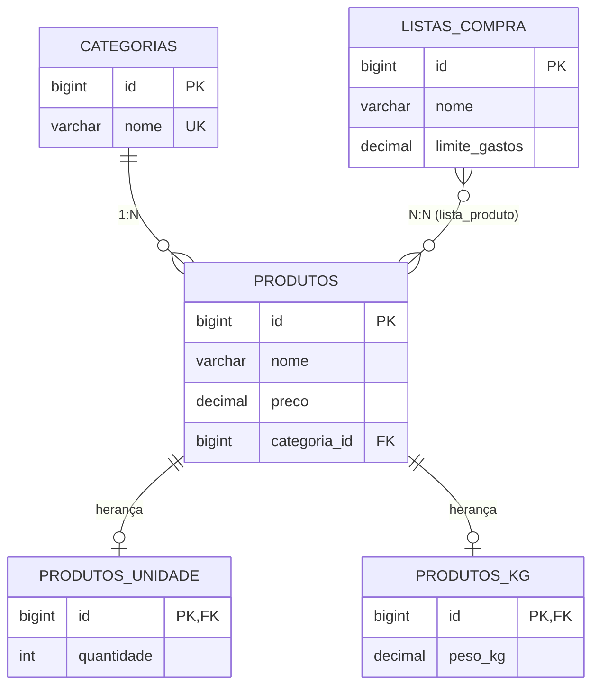

# HelpCompra API

API REST em **Spring Boot** para lista de compra em supermercado (manutenção de produtos, categorias e listas de compras). É a evolução do [helpcompra](https://github.com/JGMSX/helpcompra), que era um CRUD de console em Java: o mesmo domínio (produtos por unidade e por quilo, totais e limite de gastos), agora com persistência em banco relacional e endpoints HTTP.

## Requisitos atendidos

| Requisito | Onde está |
|---|---|
| Herança | `Produto` (abstrata) → `ProdutoUnidade` e `ProdutoKg`, estratégia `JOINED` |
| Associação 1:N | `Categoria` 1 → N `Produto` |
| Associação N:N | `ListaCompra` N ↔ N `Produto` (tabela `lista_produto`) |
| CRUD completo | Inserir, consultar, alterar e excluir em **Categoria**, **Produto** e **ListaCompra** |

## Modelo de dados



O polimorfismo do projeto original foi mantido: `calcularTotal()` multiplica o preço pela **quantidade** (`ProdutoUnidade`) ou pelo **peso** (`ProdutoKg`), e a lista soma os totais e informa se está dentro do limite de gastos.

## Tecnologias

Java 17 a 25 · Spring Boot 3.5 · Spring Web · Spring Data JPA (Hibernate) · Bean Validation · Lombok · SQLite · springdoc-openapi (Swagger UI) · JUnit 5 + MockMvc

## Como executar

Pré-requisitos: **JDK de 17 a 25** (por exemplo 21 ou 25) e **Maven 3.9+**. O JDK 26 ou mais novo ainda não é suportado por este Spring Boot.

```bash
java -version      # deve mostrar uma versão entre 17 e 25
mvn -version       # a linha "Java version" deve mostrar o mesmo JDK
```

**1. Teste automático** (na pasta que contém o `pom.xml`):

```bash
mvn test
```

Sucesso: `Tests run: 1, Failures: 0, Errors: 0` e `BUILD SUCCESS`. Na primeira vez o Maven baixa as dependências, o que leva alguns minutos.

**2. Rodar a API:**

```bash
mvn spring-boot:run
```

Sucesso: `Started HelpCompraApplication`. Depois abra:

- Swagger UI: http://localhost:8080/swagger-ui.html
- API: http://localhost:8080/api

**3. Rodar como arquivo único (apresentação/entrega):**

```bash
mvn clean package
java -jar target/helpcompra-api-1.0.0.jar
```

Os dados ficam no arquivo `helpcompra.db`, criado na pasta onde a API é iniciada (ignorado pelo git). Para recomeçar do zero, desligue a API e apague esse arquivo. Para outra porta: `--server.port=8081`.

### Problemas comuns

| Mensagem | Causa e solução |
|---|---|
| `TypeTag :: UNKNOWN` / `Unsupported class file major version` / `Java 26 ... not supported` | JDK novo demais (26 ou mais). Use o JDK 21 ou 25 e confira com `mvn -version`. |
| `invalid target release: 17` | JDK antigo. Instale o JDK 21 ou 25. |
| `Port 8080 was already in use` | Outra API está rodando. Feche-a ou use outra porta. |
| `database is locked` | Duas cópias da API usando o mesmo `helpcompra.db`. Feche uma delas. |
| `Could not transfer artifact` | Sem internet na primeira execução. |

## Endpoints

| Recurso | Método | Rota | Descrição |
|---|---|---|---|
| Categorias | GET | `/api/categorias` | Lista (ordem alfabética) |
| | GET | `/api/categorias/{id}` | Busca por id |
| | POST | `/api/categorias` | Cria |
| | PUT | `/api/categorias/{id}` | Altera |
| | DELETE | `/api/categorias/{id}` | Exclui (409 se tiver produtos) |
| Produtos | GET | `/api/produtos?categoriaId=&nome=` | Lista com filtros opcionais |
| | GET | `/api/produtos/{id}` | Busca por id |
| | POST | `/api/produtos` | Cria (`tipo`: `UNIDADE` ou `KG`) |
| | PUT | `/api/produtos/{id}` | Altera (o tipo não pode mudar) |
| | DELETE | `/api/produtos/{id}` | Exclui e remove das listas |
| Listas | GET | `/api/listas` | Lista com produtos e totais |
| | GET | `/api/listas/{id}` | Busca por id |
| | POST | `/api/listas` | Cria (aceita `produtoIds`) |
| | PUT | `/api/listas/{id}` | Altera (substitui os produtos) |
| | DELETE | `/api/listas/{id}` | Exclui (os produtos permanecem) |
| | PUT | `/api/listas/{id}/produtos/{produtoId}` | Adiciona produto à lista |
| | DELETE | `/api/listas/{id}/produtos/{produtoId}` | Remove produto da lista |

## Exemplos

```bash
# 1. Categoria
curl -X POST localhost:8080/api/categorias -H 'Content-Type: application/json' \
  -d '{"nome":"Hortifruti"}'

# 2. Produto por unidade e produto por quilo
curl -X POST localhost:8080/api/produtos -H 'Content-Type: application/json' \
  -d '{"tipo":"UNIDADE","nome":"Leite","preco":4.00,"categoriaId":1,"quantidade":3}'
curl -X POST localhost:8080/api/produtos -H 'Content-Type: application/json' \
  -d '{"tipo":"KG","nome":"Tomate","preco":8.50,"categoriaId":1,"pesoKg":1.5}'

# 3. Lista com limite de gastos
curl -X POST localhost:8080/api/listas -H 'Content-Type: application/json' \
  -d '{"nome":"Compra do mês","limiteGastos":20.00,"produtoIds":[1,2]}'
```

Resposta da lista:

```json
{
  "id": 1,
  "nome": "Compra do mês",
  "limiteGastos": 20.00,
  "produtos": [
    { "id": 1, "tipo": "UNIDADE", "nome": "Leite", "preco": 4.00, "categoriaId": 1,
      "categoria": "Hortifruti", "quantidade": 3, "pesoKg": null, "total": 12.00 },
    { "id": 2, "tipo": "KG", "nome": "Tomate", "preco": 8.50, "categoriaId": 1,
      "categoria": "Hortifruti", "quantidade": null, "pesoKg": 1.500, "total": 12.75 }
  ],
  "total": 24.75,
  "dentroDoLimite": false
}
```

Erros seguem o formato `ProblemDetail` (RFC 7807): `400` dados inválidos (com o mapa `campos`), `404` não encontrado, `409` conflito (nome de categoria repetido ou categoria com produtos).

## Estrutura

```
src/main/java/com/helpcompra/
├── model/        entidades JPA (herança, 1:N, N:N)
├── repository/   Spring Data JPA
├── dto/          records de entrada e saída
├── service/      regras de negócio e transações
├── controller/   endpoints REST
└── exception/    erros padronizados
```

## Decisões de projeto

- **Herança `JOINED`**: cada tipo tem só as colunas que usa (sem colunas nulas), e os dados comuns ficam em `produtos`.
- **Lombok com `@EqualsAndHashCode(onlyExplicitlyIncluded = true)`**: `equals` e `hashCode` das entidades usam só o `id`, o mesmo padrão adotado nas aulas.
- **SQLite**: banco em arquivo, sem instalação. A conexão é única (`maximum-pool-size=1`) porque o SQLite aceita uma escrita por vez.
- **Tratamento de erros**: `GlobalExceptionHandler` devolve 400 (validação), 404, 409 (conflito e violação de integridade) e 500 (erro inesperado) no formato `ProblemDetail`.
- **DTOs em vez de expor entidades**: evita loops de serialização e deixa o contrato da API estável.
- **`open-in-view` desligado**: o acesso lazy acontece dentro da camada de serviço, sem consultas escondidas na serialização.
- **Um endpoint para os dois tipos de produto**: o campo `tipo` define quais campos são obrigatórios.

## Próximos passos

Subtotal por categoria e "concluir compra" (presentes no menu do projeto original), paginação, autenticação (Spring Security + JWT) e migrações com Flyway.
